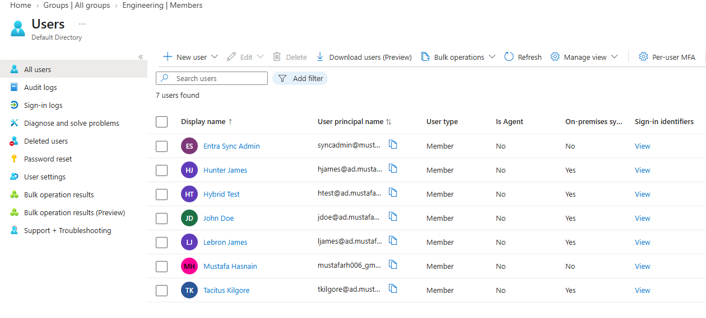
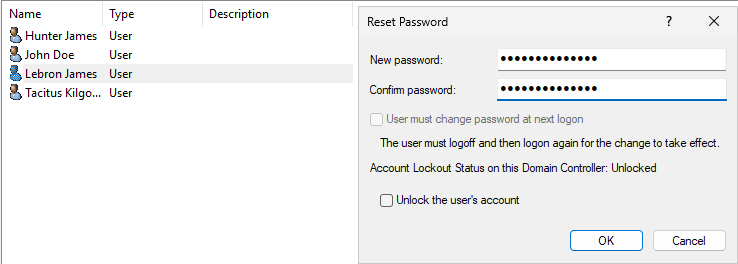
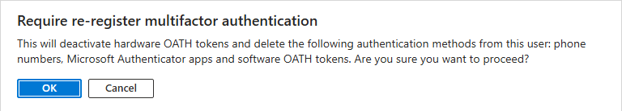

# Microsoft Entra ID Lab

This project extends my [Active Directory Home Lab](https://github.com/MustafaHas9/Active-Directory-Home-Lab) by connecting my on-premises Active Directory environment to Microsoft Entra ID.

I used Microsoft Entra Connect Sync to synchronize AD users and security groups, allowing users to sign in to Microsoft cloud services with their existing AD credentials.

## Environment

- **Windows Server 2025** — Active Directory and DNS
- **Microsoft Entra ID** — Cloud user and group management
- **Microsoft Entra Connect Sync** — Directory and password synchronization
- **VirtualBox** — Virtual machines

## What I Configured

- Set up a dedicated Windows Server VM for Entra Connect.
- Verified a custom domain and updated AD usernames to use it.
- Selected specific Organizational Units to synchronize instead of the entire domain.
- Synchronized five AD users and four departmental security groups.
- Verified user and group sync, and confirmed that the same AD password works for both local Windows and Microsoft cloud log-ins.

### Synchronized Users

## Help Desk Scenarios

### Password Reset

Reset an employee's password in Active Directory and verified that the new password worked for both local Windows and Microsoft cloud sign-ins.

### MFA Reset

Simulated an employee losing access to Microsoft Authenticator. Required MFA re-registration through Entra ID and confirmed that the employee could set up Authenticator again.

## Documentation

- [Setup and Configuration](docs/setup.md)
- [Troubleshooting](docs/troubleshooting.md)
