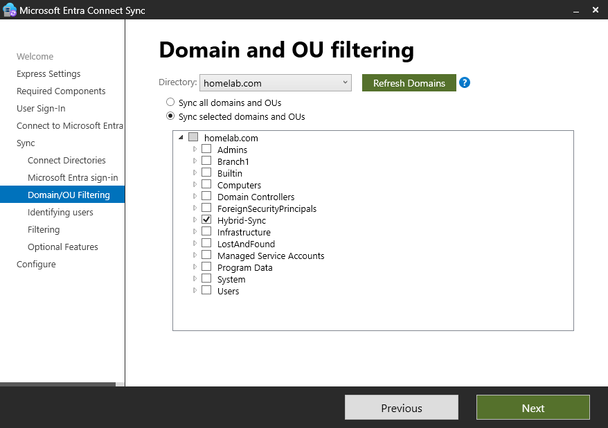
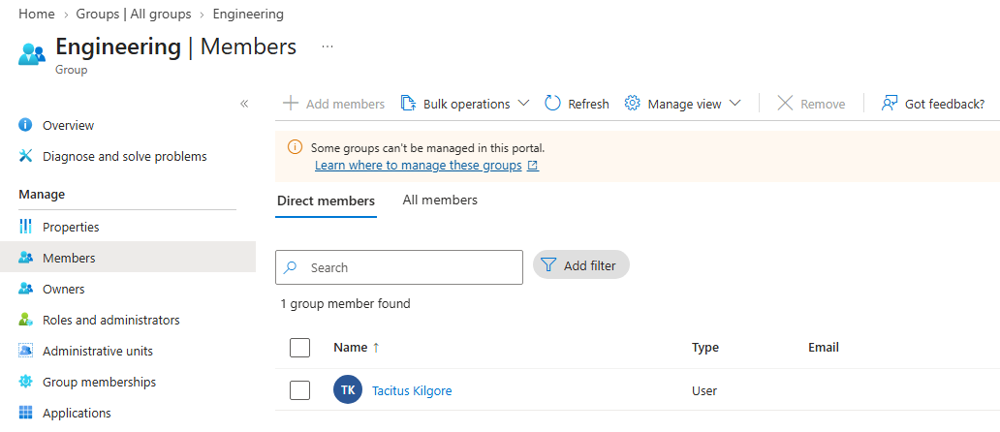

# Setup and Configuration

## 1. Microsoft Entra ID

- Created a Microsoft Entra ID Free tenant with Global Administrator access.
- Verified ownership of `ad.mustafahasnain.com` using a Cloudflare DNS TXT record.
- Created a separate cloud administrator with the Hybrid Identity Administrator role for configuring Entra Connect.

## 2. On-Premises Active Directory

Used my existing Windows Server 2025 Active Directory environment (`homelab.com`).

- **DC01:** Active Directory and DNS (`192.168.10.10`)
- **RRAS01:** Network gateway and NAT (`192.168.10.1`)
- **SYNC01:** Dedicated Entra Connect server (`192.168.10.30`)

Since `homelab.com` isn't a publicly verified domain, I added `ad.mustafahasnain.com` as an alternative UPN suffix through Active Directory Domains and Trusts.

Updated the employee accounts to use the verified domain for their usernames while keeping the existing AD domain unchanged.

## 3. Microsoft Entra Connect Sync

Installed Microsoft Entra Connect Sync on SYNC01, a Windows Server 2025 VM joined to `homelab.com`.

Configured password synchronization so users could access Microsoft cloud services using their existing Active Directory passwords.

Rather than synchronizing the entire domain, I selected specific OUs:

- `Hybrid-Sync` — Initial test account
- `Branch1/Users` — Employee accounts
- `Branch1/Departments` — Departmental security groups

Initially synchronized one test user, then expanded synchronization to include the employee accounts and security groups.

### OU Filtering

*Initial configuration showing the test OU before expanding synchronization.*

## 4. Verification

Confirmed that five Active Directory users and four departmental security groups synchronized to Microsoft Entra ID.

Verified that the Engineering group's membership matched the on-premises Active Directory configuration.

Tested signing in to both the local Windows domain and Microsoft cloud services using the same Active Directory credentials.

## 5. Help Desk Testing

After configuring synchronization, I tested two common account administration tasks:

- **Password reset:** Reset an employee's password in Active Directory and verified the new password worked for both local and Microsoft cloud sign-ins.
- **MFA reset:** Required an employee to re-register Microsoft Authenticator through Entra ID and confirmed the new registration worked.

Screenshots of these tests are included in the [main README](../README.md).

For issues encountered during configuration, see [Troubleshooting](troubleshooting.md).
