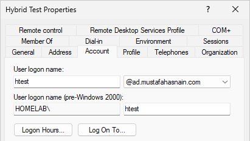
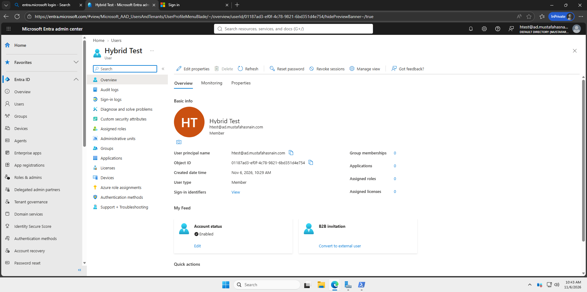

# Troubleshooting and Lessons Learned

During this project, I ran into a few issues with user synchronization, DNS, and network connectivity. Here's what happened and how I addressed them.

## 1. Incorrect Username in Entra ID

When I first synchronized my test user, Entra ID assigned an `onmicrosoft.com` username instead of the custom domain I wanted to use.

The user's original AD username was `htest@homelab.com`. Since `homelab.com` wasn't verified in Entra ID, the user received a different cloud UPN.

To fix this, I added `ad.mustafahasnain.com` as an alternative UPN suffix in Active Directory and changed the test user's username to use it. I then ran another synchronization.

**Updated username in Active Directory:**

After synchronization, the username in Entra ID matched the updated AD username.

**Updated username in Microsoft Entra ID:**

This helped me understand that the on-premises AD domain and a user's cloud sign-in domain don't have to be the same.

## 2. DNS and Network Connectivity

While setting up SYNC01, I ran into intermittent internet connectivity and DNS resolution problems.

I checked the network configuration, added external DNS forwarders on DC01, and removed an unused network adapter from RRAS01.

After restarting the affected virtual machines, external connectivity and DNS resolution worked again.

I wasn't able to isolate the exact cause, but the experience showed me how problems with DNS and network configuration can affect services that depend on an internet connection.

## 3. Delayed User and Group Synchronization

After expanding Entra Connect to include my employee accounts and departmental security groups, they didn't immediately appear in Entra ID.

I checked that the correct OUs were selected and reviewed the synchronization status in Synchronization Service Manager. Some older operations showed connection errors, while newer operations completed successfully.

I then ran an initial synchronization cycle and checked Entra ID again. The missing users and groups eventually appeared.

The main takeaway was that a successful synchronization operation doesn't necessarily mean every expected object is already visible in Entra ID. It's worth checking the selected OUs, synchronization status, and allowing time for changes to appear.
